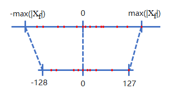

# Quantization

MindIE SD provides two types of quantization capabilities, applied to different parts of the model:

- **Linear Quantization**: Applies low-bit processing (INT8/FP8/W8A16, etc.) to linear layer weights and activations, reducing model storage and computation overhead.
- **FA Quantization**: Applies FP8 block quantization to Q/K/V activations in attention computation, reducing memory bandwidth requirements.

The following two sections describe the principles and usage of each quantization type.

## Linear Quantization

### General Principles

Quantization is the process of mapping model weights and activations from high precision (e.g., FP32) to low precision (e.g., INT8, FP8). Low-precision computation reduces memory usage and bandwidth requirements, improving inference throughput.

Based on whether retraining is needed, quantization is divided into Post-Training Quantization (PTQ) and Quantization-Aware Training (QAT). This section focuses on PTQ quantization, which falls into three main types:

- **Dynamic Quantization**: Only weights are quantized offline; activation quantization factors are dynamically computed during inference.
- **Static Quantization**: Both weights and activations are quantized offline.
- **Time-Aware Quantization**: Quantization strategy is dynamically adjusted based on the time dimension.

The following diagram shows an INT8 quantization example, mapping FP32 to INT8. `[-max(xf), max(xf)]` is the pre-quantization float range, and `[-128, 127]` is the post-quantization range.



### Technical Features

This repository handles Linear quantization through `quantize`. The table lists algorithm enums; executable paths and selection limits are described in the recommendations below.

**Weight Quantization** (only weights are quantized; activations remain at original precision):

| Algorithm | Weight Precision | Description |
| ------ | ---------- | ------ |
| W8A16 | INT8 | Basic weight quantization |
| W4A16 | INT4 | Higher compression ratio |
| W4A16_AWQ | INT4 + AWQ | Activation-aware weight quantization |
| W8A16_GPTQ | INT8 + GPTQ | GPTQ post-training weight quantization |
| W4A16_GPTQ | INT4 + GPTQ | Same as above, INT4 version |

**Weight-Activation Quantization** (both weights and activations are quantized; computation done in low precision):

| Algorithm | Quantization Granularity | Description |
| ------ | ---------- | ------ |
| W8A8 | Per-layer | Basic INT8 weight-activation quantization |
| W8A8_TIMESTEP | Per-layer + timestep | Dynamically switch quantization strategy during inference |
| W8A8_DYNAMIC | Per-layer | Dynamic activation quantization |
| W8A8_PER_CHANNEL | Per-channel | Channel-granularity quantization |
| W8A8_PER_TENSOR | Per-tensor | Tensor-granularity quantization |
| W8A8_MXFP8 | Per-layer | MXFP8 format quantization |
| W4A4_DYNAMIC | Per-token + per-channel | INT4 weight-activation quantization |
| W4A4_MXFP4_SVD | Per-layer | Unsupported by the current entry point |
| W4A4_MXFP4_DUALSCALE | Per-layer | MXFP4 dual-scale quantization |
| W4A4_MXFP4_DYNAMIC | Per-token + per-channel | MXFP4 dynamic quantization |
| W4A4_MXFP4_FOUROVERSIX_DYNAMIC | Per-token + per-channel | MXFP4 quantization with activations via `quant_four_over_six_a5` (4/6 adaptive) |

### Quantization Recommendations

Use [msModelSlim](https://gitcode.com/Ascend/msmodelslim) to produce offline quantized weights and descriptors, then load them with MindIE SD for inference. See its [algorithm overview](https://gitcode.com/Ascend/msmodelslim/tree/master/docs/zh/knowledge_base/quantization_algorithms) for tool parameters. Start with an existing recipe for the target model and select a compatible inference path below.

| Requirement | MindIE SD inference path | msModelSlim algorithm and rationale |
| --- | --- | --- |
| Establish an INT8 baseline | `W8A8` / `W8A8_DYNAMIC` | Start with [MinMax](https://gitcode.com/Ascend/msmodelslim/blob/master/docs/zh/knowledge_base/quantization_algorithms/minmax/usage_minmax.md); add [SmoothQuant](https://gitcode.com/Ascend/msmodelslim/blob/master/docs/zh/knowledge_base/quantization_algorithms/smooth_quant/usage_smooth_quant.md) in the tool when activation outliers require smoothing before export. The dynamic path computes activation scales at runtime |
| No calibration data; retain activation precision | `W8A16` | [HQQ](https://gitcode.com/Ascend/msmodelslim/blob/master/docs/zh/knowledge_base/quantization_algorithms/hqq/usage_hqq.md) uses INT8 per-channel weights and floating-point activations without calibration data, reducing weight storage |
| Reduce MXFP8 weight reconstruction error | `W8A8_MXFP8` | [MSE_Round](https://gitcode.com/Ascend/msmodelslim/blob/master/docs/zh/knowledge_base/quantization_algorithms/mse_round/usage_mse_round.md) selects ceil/floor shared exponents per block using MSE; inference still quantizes activations dynamically to MXFP8 |
| MXFP4 compression and computation | `W4A4_MXFP4_DYNAMIC` | Start with [Ceil_X](https://gitcode.com/Ascend/msmodelslim/blob/master/docs/zh/knowledge_base/quantization_algorithms/ceil_x/usage_ceil_x.md), whose default divisor is 7.25; ceil shared exponents reduce clipping of large values. Evaluate tool-side search or local fallback if accuracy is insufficient |
| Reduce MXFP4 block scaling error | `W4A4_MXFP4_FOUROVERSIX_DYNAMIC` | [FouroverSix](https://gitcode.com/Ascend/msmodelslim/blob/master/docs/zh/knowledge_base/quantization_algorithms/fouroversix/usage_fouroversix.md) selects Scale-to-4 or Scale-to-6 per block by reconstruction error. The tool optimizes weights; this repository additionally applies adaptive 4/6 activation quantization on A5, requiring bf16 and a last dimension divisible by 32 |
| MXFP4 with problematic outlier channels | `W4A4_MXFP4_DUALSCALE` | [DualScale](https://gitcode.com/Ascend/msmodelslim/blob/master/docs/zh/knowledge_base/quantization_algorithms/dual_scale/usage_dual_scale.md) adds a second scale level. Use only with a compatible model and operator layout; ordinary MXFP4 weights are not interchangeable |
| Diffusion timesteps sensitive to low precision | `W8A8_TIMESTEP` or an MXFP4 timestep policy | Export compatible artifacts with [Linear Quant](https://gitcode.com/Ascend/msmodelslim/blob/master/docs/zh/knowledge_base/quantization_algorithms/linear_quant/usage_linear_quant.md) and control the policy with `TimestepManager`. MXFP4 can use W4A8 on sensitive steps while retaining MXFP4 weights; see the examples below |

Tool algorithm names are not `QuantAlgorithm` values. For example, `ceil_x` and `mse_round` estimate weight quantization parameters and must not be used as layer types in a descriptor. Check descriptor values, weight names, scale granularity and layouts after export. See [Linear Quant](https://gitcode.com/Ascend/msmodelslim/blob/master/docs/zh/knowledge_base/quantization_algorithms/linear_quant/usage_linear_quant.md) for model adaptation and export requirements.

The weight-only entry currently replaces only `W8A16` / `W4A16`; AWQ/GPTQ enums have no replacement branch, and `W4A4_MXFP4_SVD` raises an unsupported-algorithm error. Tool-side AWQ, GPTQ and SVDQuant are therefore not recommended as executable paths in this repository.

Compare the same model, inputs, seed and sampling steps. Check layer errors and generation quality before measuring end-to-end latency and peak memory. Prefer sensitive-layer or timestep fallback when accuracy is insufficient; fewer bits do not guarantee lower latency.

### API and Usage

All Linear quantization algorithms are triggered uniformly through the `quantize` API.

```python
from mindiesd import quantize
```

#### Parameters

| Parameter | Type | Required | Default | Description |
| ------ | ------ | ------ | -------- | ------ |
| `model` | `nn.Module` | Yes | - | Initialized floating-point model |
| `quant_json_path` | `str` | Yes | - | Path to quantization descriptor JSON containing algorithm, layer configuration, etc. |

#### Usage Examples

Basic quantization:

```python
model = from_pretrain()
model = quantize(model, "quant_model_description_w8a16_0.json")
model.to("npu")
```

Timestep quantization:

```python
from mindiesd import TimestepManager

model = quantize(model, "quant_model_description_w8a8_timestep_0.json",
                 timestep_policy=TimestepPolicyConfig(...))

for i, t in enumerate(timesteps):
    TimestepManager.set_timestep_idx(i)
    ...
```

#### 4/6 Adaptive Activation Quantization (fouroversix)

`W4A4_MXFP4_FOUROVERSIX_DYNAMIC` reuses the weight path of `W4A4_MXFP4_DYNAMIC` and replaces activation quantization with the custom operator `quant_four_over_six_a5`: each 32-element block adaptively selects between D4/D6 E8M0 scales based on quantization error. The `W4A8` timestep fallback behaves the same as `W4A4_MXFP4_DYNAMIC`.

- Quantized weights are identical to those of `W4A4_MXFP4_DYNAMIC` and can be reused directly; when the descriptor `model_quant_type` is `W4A4_MXFP4_FOUROVERSIX`, the weight file follows the naming rule as `quant_model_weight_w4a4_mxfp4_fouroversix_{rank}.safetensors`.
- The operator requires bf16 input and a 32-aligned activation tail axis (`in_features`), and is supported on 950PR&950DT products; misaligned layers fail fast at construction time.
- `mxfp4_scale_alg` / `mxfp4_dst_type_max` only affect weight quantization; activations always use the fixed 4/6 adaptive combination.
- The online path is also supported: `OnlineQuantConfig(quant_type=W4A4_MXFP4_FOUROVERSIX_DYNAMIC)`.

#### Quantized Weight File Naming

Quantized weights and descriptor files are exported by the msmodelslim tool with the following naming convention:

- Weight file: `quant_model_weight_{quant_algo.lower()}_{rank}.safetensors`
- Descriptor file: `quant_model_description_{quant_algo.lower()}_{rank}.json`

For single-card quantization, `rank` is 0. For multi-card parallelism, each rank corresponds to its respective number.

#### Quantization Descriptor Validation

`quantize` validates the complete descriptor before constructing quantization configs or opening the weight file. The supported MindIE SD format is a flat JSON object:

```json
{
  "model_quant_type": "W8A8",
  "blocks.0.proj.weight": "W8A8",
  "blocks.0.proj.bias": "FLOAT"
}
```

- The file must be a UTF-8 standard JSON object without duplicate fields, unescaped control characters, or nonstandard constants such as `NaN` and `Infinity`.
- `model_quant_type` is required. Its value must be a string that exactly matches a `QuantAlgorithm` enum value, such as `W8A8` or `W4A4_MXFP4`. It is file-level metadata, not a layer config.
- Known AscendV1 exporter metadata is optional: `version`, `kv_cache_type`, `kv_quant_type`, `fa_quant_type`, and `reduce_quant_type` must be strings; `group_size` must be a non-negative integer, excluding booleans; `metadata` and `optional` must be JSON objects. The string values of fields that MindIE SD does not consume are intentionally not restricted to today's exporter enum values, so newer exporters remain forward compatible. These fields are validated and excluded from layer configs; they do not enable grouped, KV-cache, communication, or rotation features. Objects inside `metadata` and `optional` are exporter extensions and are not interpreted or used to open additional files.
- All remaining fields are dynamic layer or tensor names. Names must not be entirely whitespace or contain ASCII control characters. Values must be strings containing a `QuantAlgorithm` enum value (case-insensitive) or exactly `FLOAT`.
- Fields that violate this format are rejected instead of silently ignored. Dynamic names are not a fixed whitelist: an unfamiliar name with a valid algorithm value is a layer entry. All JSON numbers, including those in metadata objects, must be finite.
- Validation failures raise `ParametersInvalid` with the field name or JSON line and column. The weight file is not opened after a validation failure.

This checks the descriptor structure, types, and values. It does not verify that dynamic names correspond to actual model layers, or validate weight tensor shapes, values, or quantization accuracy. Existing path, symbolic link, file size, and permission checks still apply.

## FA Quantization

### FA General Principles

FA (Flash Attention) quantization applies low-bit processing to Q/K/V activations in attention computation. Quantizing Q/K/V to FP8 before feeding into attention computation kernels significantly reduces memory bandwidth requirements and improves inference throughput. Unlike weight quantization, FA quantization processes dynamically generated activations during inference and requires block-level dynamic quantization strategies to balance accuracy and acceleration.

### FA Technical Features

This repository provides FA quantization via the `FP8_DYNAMIC` and `MXFP4_DYNAMIC` algorithms, with a three-step processing flow:

#### Rotate

If the quantized weights contain pre-trained rotation matrices (`q_rot`, `k_rot`), apply them to Q and K so outliers are spread across dimensions and FP8 quantization is less sensitive to those outliers. If the two tensors are absent, rotation is skipped and module initialization still succeeds.

#### Block Quantization

Dynamically quantize Q/K/V into FP8 (`float8_e4m3fn`) block by block via `npu_dynamic_block_quant`. Q uses a 128-token block and K uses a 256-token block; the V token block is selected by `FP8FAMode` below.

#### FP8 Attention

Invoke MindIE SD's own `torch.ops.mindiesd.fused_infer_attention_score_v2` operator, which routes to the migrated `FusedInferAttentionScore` implementation
in this repository, to perform attention computation in the FP8 domain with
outputs dequantized back to original precision. `FP8RotateQuantFA` selects the quantization blocks, `value_quant_mode`, and `inner_precise` together through the `FP8FAMode` enum, so those switches stay aligned.

| Mode | Q/K/V quant mode | `inner_precise` | V quant block |
| ------ | ------ | ------ | ------ |
| `HIGH_PRECISION` (default) | `7/7/7` | omitted (original high-precision path) | 256×128 |
| `C8V16_TILING512` | `7/7/12` | `4` (C8V16) | 512×64 |

Later features should be added as new enum members instead of unbound quant switches.

In addition to `FP8_DYNAMIC` and `MXFP4_DYNAMIC`, `MXFP4_FOUROVERSIX_DYNAMIC` replaces the Q/K activation quantization of MXFP4 FA with `quant_four_over_six_a5` (4/6 adaptive). The operator only supports the tail axis, while `quant_flash_attn` requires V to be block-quantized along the sequence axis, so V still goes through `npu_dynamic_mx_quant`.

### FA Selection and Tool Algorithms

The Q/K/V formats, block sizes and rotation weights for `FP8_DYNAMIC`, `MXFP8_DYNAMIC`, `MXFP4_DYNAMIC` and `MXFP4_FOUROVERSIX_DYNAMIC` must match the inference operators. The tool's [FA3 Quant guide](https://gitcode.com/Ascend/msmodelslim/blob/master/docs/zh/knowledge_base/quantization_algorithms/fa3_quant/usage_fa3_quant.md) explains attention activation quantization and `dtype` / `scope` configuration. Its default INT8 per-head artifacts cannot be loaded directly into this repository's FP8/MXFP FA paths.

Validate FP8 first. Consider MXFP4 and sensitive-timestep fallback only when the target device supports them and generation quality is acceptable. Tool-side rotation or scaling must match the model adaptation and exported artifacts.

### API Reference

FA quantization is triggered uniformly through the `quantize` API; no separate FA quantization API call is needed.

```python
from mindiesd import quantize
```

#### Usage Example

```python
from mindiesd import quantize

# Load original floating-point model
model = from_pretrain()

# Execute quantization conversion (automatically identifies Attention layers and injects FA quantization)
model = quantize(model, "path/to/exported/quantization/config")

# Move model to NPU and run inference
model.to("npu")
```

`quantize` internally traverses model layers, automatically calling `add_fa_quant` on matching Attention layers, injecting `FP8RotateQuantFA` modules, and replacing the forward computation with the rotate -> block quantize -> FP8 Attention flow. The default mode is `FP8FAMode.HIGH_PRECISION`. To use C8V16 with a 512-token V tile:

```python
from mindiesd import FP8FAMode, QuantConfig, quantize

model = quantize(
    model,
    "path/to/exported/quantization/config",
    quant_config=QuantConfig(fp8_fa_mode=FP8FAMode.C8V16_TILING512),
)
```

FA quantization layers are implemented through the `FP8RotateQuantFA` module. See the rotate -> block quantize -> FP8 Attention flow description in this section. `C8V16_TILING512` requires the FIA C8V16 + V512 path (`inner_precise=4`, `value_quant_mode=12`).

#### Notes

- Hardware requirement: Only Atlas 800I A2 inference server support this feature.
- Q/K/V input layout supports both `BNSD` and `BSND`.
- K/V may have fewer heads than Q (GQA, Grouped Query Attention). `FP8RotateQuantFA` passes `num_key_value_heads` from the K head count.
- Rotation matrices (`q_rot`, `k_rot`) are optional. When used, they must be pre-exported with the msmodelslim model compression tool; see the msmodelslim documentation. If the two tensors are absent, `FP8RotateQuantFA` skips rotation.
